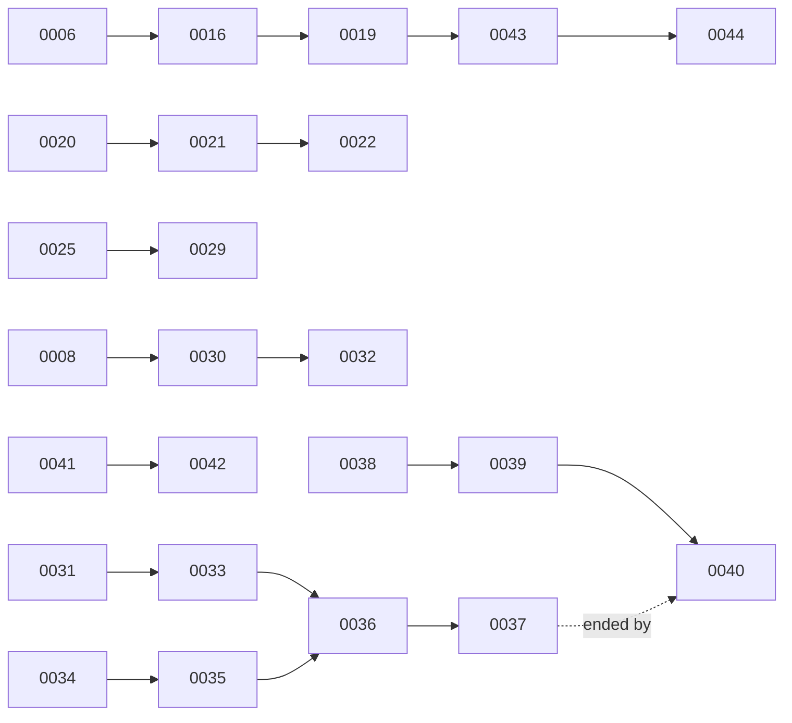

# Architecture decisions

Each numbered record explains one choice: the situation, the decision, the alternatives, and the costs accepted. Decisions are history, not deployment instructions. An Accepted decision can still describe an experiment that a later decision ended, so follow the chain to the newest relevant record.

The original 40 decisions keep their dates and statuses; their public editions were condensed in October 2026. Later decisions are public from their first edition. The [decision policy](../reference/decisions-policy.md) explains statuses and supersession, and the [capabilities map](../overview/capabilities.md) shows what runs today.

## Supersession chains

A solid arrow points from a decision to the one that superseded it. The dashed arrow marks a decision that stayed Accepted but whose platform a later decision retired.

| Chain | Topic | Ends at |
| --- | --- | --- |
| 0006 → 0016 → 0019 → 0043 → 0044 | SeaweedFS interface, placement, and stock runtime | [0044](0044-use-stock-shared-s3-with-planned-downtime.md) |
| 0020 → 0021 → 0022 | Cilium memory and clean-state | [0022](0022-keep-3584mi-cilium-limit-reject-permanent-cleanstate.md) |
| 0025 → 0029 | Network policy and Pod Security | [0029](0029-restore-pod-security-isolate-public-workloads.md) |
| 0008 → 0030 → 0032 | Logging backend and retention | [0032](0032-honor-loki-stream-retention-minimum.md) |
| 0041 → 0042 | Log-delivery canaries | [0042](0042-bound-numbered-log-confirmation-deadlines.md) |
| 0031 → … → 0040 | Lakehouse, from demo to retirement | [0040](0040-retire-lakehouse-and-temporal.md) |

## All decisions

| ID | Decision | Status | Date |
| --- | --- | --- | --- |
| 0001 | [Cluster reset and structured rebuild](0001-cluster-reset-and-structured-rebuild.md) | Accepted | 2026-04-10 |
| 0002 | [Defer Rook-Ceph](0002-defer-rook-ceph.md) | Deferred | 2026-04-10 |
| 0003 | [Defer monitoring stack pending object storage](0003-defer-monitoring-stack-pending-storage.md) | Deferred | 2026-04-11 |
| 0004 | [Storage stack framework](0004-storage-stack-framework.md) | Accepted | 2026-04-11 |
| 0005 | [Adopt Longhorn for replicated block storage](0005-adopt-longhorn-for-block-storage.md) | Accepted | 2026-04-11 |
| 0006 | [Adopt SeaweedFS for object storage](0006-adopt-seaweedfs-for-object-storage.md) | Superseded by [0016](0016-adopt-seaweedfs-today-via-filerspec-s3.md) | 2026-04-11 |
| 0007 | [Adopt kube-prometheus-stack for metrics](0007-adopt-kube-prometheus-stack.md) | Accepted | 2026-04-12 |
| 0008 | [OpenTelemetry logs and traces roadmap](0008-opentelemetry-logs-and-traces-roadmap.md) | Superseded by [0030](0030-adopt-loki-for-kubernetes-logs.md) | 2026-04-12 |
| 0009 | [10 Gbit SFP+ full-mesh storage networking](0009-10g-sfp-full-mesh-networking.md) | Accepted | 2026-04-15 |
| 0010 | [Persist Tailscale node identity](0010-persistent-tailscale-node-names.md) | Accepted | 2026-04-15 |
| 0011 | [Adopt an in-repository planning system](0011-adopt-in-repo-planning-system.md) | Accepted | 2026-04-16 |
| 0012 | [Tailscale for internal remote workload access](0012-tailscale-for-internal-remote-workload-access.md) | Accepted | 2026-04-16 |
| 0013 | [Restructure the cluster-health dashboard](0013-restructure-grafana-cluster-health-dashboard.md) | Accepted | 2026-04-17 |
| 0014 | [Clean failed pods with a Flux-managed CronJob](0014-pod-gc-cronjob.md) | Accepted | 2026-04-17 |
| 0015 | [Adopt Harbor as the in-cluster image registry](0015-adopt-harbor-for-image-registry.md) | Accepted | 2026-04-18 |
| 0016 | [Adopt SeaweedFS using embedded filer S3](0016-adopt-seaweedfs-today-via-filerspec-s3.md) | Superseded by [0019](0019-seaweedfs-on-canonical-spec-s3.md) | 2026-04-18 |
| 0017 | [Adopt Multus for the Longhorn storage network](0017-adopt-multus-for-longhorn-storage-network.md) | Accepted | 2026-04-18 |
| 0018 | [Install CNI reference plugins for Multus](0018-install-cni-init-container-for-multus-reference-plugins.md) | Accepted | 2026-04-19 |
| 0019 | [SeaweedFS with the canonical `spec.s3` interface](0019-seaweedfs-on-canonical-spec-s3.md) | Superseded by [0043](0043-keep-two-seaweedfs-copies-for-maintenance.md) | 2026-04-19 |
| 0020 | [Size Cilium memory for cgroup working set](0020-size-cilium-memory-limit-for-cgroup-wss.md) | Superseded by [0021](0021-raise-cilium-memory-and-clean-state-on-restart.md) | 2026-04-21 |
| 0021 | [Raise Cilium memory and clean state on restart](0021-raise-cilium-memory-and-clean-state-on-restart.md) | Superseded by [0022](0022-keep-3584mi-cilium-limit-reject-permanent-cleanstate.md) | 2026-04-23 |
| 0022 | [Keep the Cilium memory limit; reject permanent clean-state](0022-keep-3584mi-cilium-limit-reject-permanent-cleanstate.md) | Accepted | 2026-04-23 |
| 0023 | [Use one shared Cloudflare Tunnel for public ingress](0023-shared-cloudflare-tunnel-only.md) | Accepted | 2026-04-29 |
| 0024 | [Use Flux image automation for owned applications](0024-adopt-image-automation-for-owned-apps.md) | Accepted | 2026-05-01 |
| 0025 | [Keep chart NetworkPolicies enabled and repair probe gaps](0025-keep-chart-networkpolicies-fix-probes-upstream.md) | Superseded by [0029](0029-restore-pod-security-isolate-public-workloads.md) | 2026-05-04 |
| 0026 | [Use self-hosted ntfy for alert notifications](0026-adopt-self-hosted-ntfy-for-alerts.md) | Accepted | 2026-05-04 |
| 0027 | [Require explicit Flux dependencies for custom resources](0027-platform-dependson-rule.md) | Accepted | 2026-05-07 |
| 0028 | [Run ClickStack as a time-boxed observability experiment](0028-clickstack-learning-experiment.md) | Accepted | 2026-06-03 |
| 0029 | [Restore Pod Security and isolate public workloads](0029-restore-pod-security-isolate-public-workloads.md) | Accepted | 2026-07-09 |
| 0030 | [Adopt Loki for Kubernetes logs](0030-adopt-loki-for-kubernetes-logs.md) | Superseded by [0032](0032-honor-loki-stream-retention-minimum.md) | 2026-08-02 |
| 0031 | [Adopt a SeaweedFS Iceberg log demo](0031-adopt-seaweedfs-iceberg-log-demo.md) | Superseded by [0033](0033-adopt-airflow-spark-operator-lakehouse.md) | 2026-08-06 |
| 0032 | [Honor Loki's stream retention minimum](0032-honor-loki-stream-retention-minimum.md) | Accepted | 2026-08-11 |
| 0033 | [Adopt Airflow and Spark Operator for the lakehouse](0033-adopt-airflow-spark-operator-lakehouse.md) | Superseded by [0036](0036-continue-airflow-lakehouse-without-metadata-recovery.md) | 2026-08-11 |
| 0034 | [Adopt the Barman Cloud plugin for CNPG backups](0034-adopt-barman-cloud-plugin-cnpg-backups.md) | Superseded by [0035](0035-defer-airflow-metadata-backups.md) | 2026-08-12 |
| 0035 | [Defer Airflow metadata backups](0035-defer-airflow-metadata-backups.md) | Superseded by [0036](0036-continue-airflow-lakehouse-without-metadata-recovery.md) | 2026-08-12 |
| 0036 | [Continue the lakehouse without metadata recovery](0036-continue-airflow-lakehouse-without-metadata-recovery.md) | Superseded by [0037](0037-remove-extended-airflow-observation-gate.md) | 2026-08-13 |
| 0037 | [Remove the extended Airflow observation gate](0037-remove-extended-airflow-observation-gate.md) | Accepted | 2026-08-14 |
| 0038 | [Extend the Airflow and Spark learning review once](0038-extend-airflow-spark-lakehouse-learning-review.md) | Superseded by [0039](0039-retain-airflow-spark-learning-platform.md) | 2026-08-14 |
| 0039 | [Retain Airflow and Spark as a learning platform](0039-retain-airflow-spark-learning-platform.md) | Superseded by [0040](0040-retire-lakehouse-and-temporal.md) | 2026-08-14 |
| 0040 | [Retire the lakehouse and Temporal](0040-retire-lakehouse-and-temporal.md) | Accepted | 2026-10-12 |
| 0041 | [Adopt Loki stdout canaries](0041-adopt-loki-stdout-canaries.md) | Superseded by [0042](0042-bound-numbered-log-confirmation-deadlines.md) | 2026-10-19 |
| 0042 | [Bound numbered log confirmation deadlines](0042-bound-numbered-log-confirmation-deadlines.md) | Accepted | 2026-10-19 |
| 0043 | [Keep two SeaweedFS copies for node maintenance](0043-keep-two-seaweedfs-copies-for-maintenance.md) | Superseded by [0044](0044-use-stock-shared-s3-with-planned-downtime.md) | 2026-10-19 |
| 0044 | [Use stock shared S3 with planned downtime](0044-use-stock-shared-s3-with-planned-downtime.md) | Accepted | 2026-10-20 |
