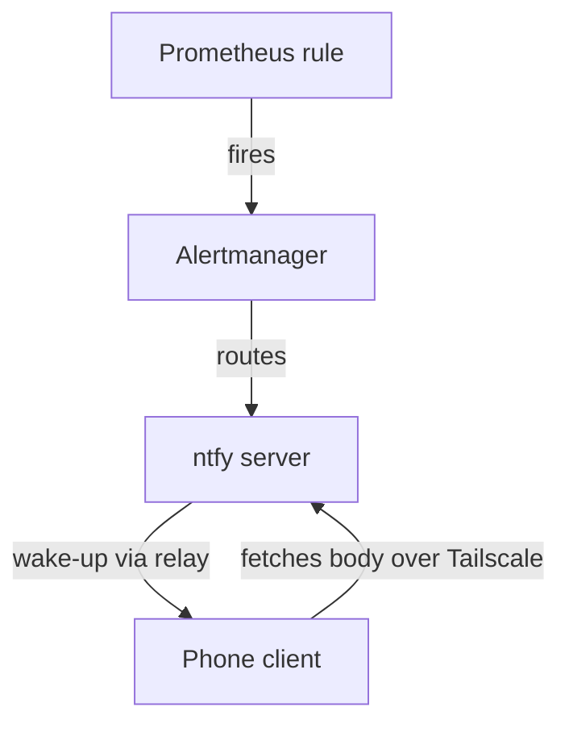

# Alert delivery

An alert passes through three stages before it reaches a phone. Each can fail on its own: a rule can fire correctly while delivery fails, so check the stages separately.

| Stage | Owner | Check |
| --- | --- | --- |
| Evaluate | Prometheus | Is the named alert firing? |
| Route | Alertmanager | Does a route match it, and was it sent? |
| Deliver | ntfy | Is ntfy ready, and do its recent logs show the message? |

## Read-only check

Inspect the named alert and its Alertmanager route, then ntfy's readiness and a bounded window of its logs. Do not print the notification topic, provider credentials, or generated Secret values. The topic works like a password; it belongs in the operator's credential store.

## Subscribe a phone

1. Connect the device to Tailscale.
2. Open the private ntfy server.
3. Subscribe with the server URL and topic from the approved credential source.

Keep the real URL and topic out of documentation and screenshots.

On iOS, the upstream relay only sends a wake-up signal. The client then fetches the message body from the private server, which requires tailnet access. A successful upstream push therefore does not prove delivery.

## End-to-end test

Sending a test notification creates real traffic and needs operator approval. The `ntfy-alert-triage` skill names the alert, interval, route, expected transition, and cleanup. The design rationale is in [ADR 0026](../decisions/0026-adopt-self-hosted-ntfy-for-alerts.md).
