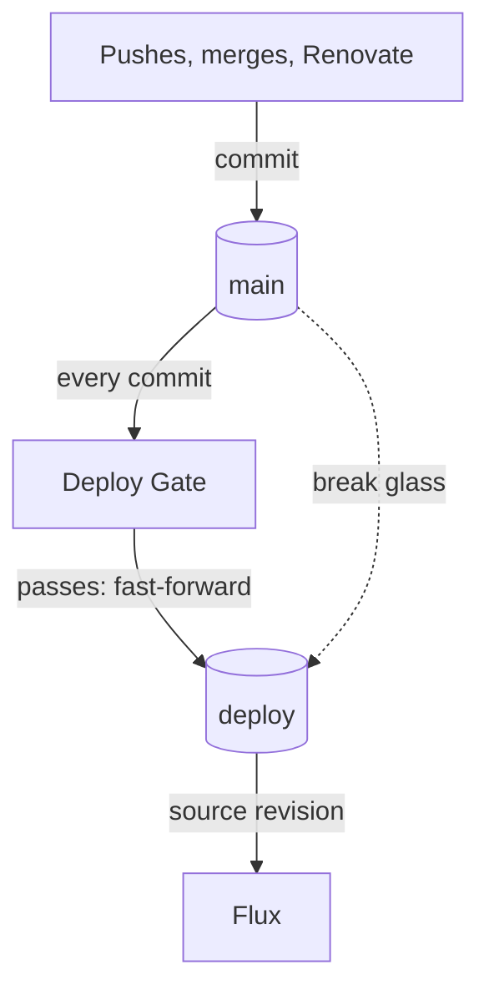

# Deploying changes

The deploy gate validates every commit on `main` and fast-forwards the `deploy` branch to the commits that pass. Once Flux reconciles `deploy`, only those commits reach the cluster. You still commit to `main` the same way. [ADR 0045](../decisions/0045-deploy-only-validated-commits.md) records why.



:::note Cutover pending
Flux still reconciles `main` until the cutover described below lands. Until then the gate runs in shadow mode: it validates every commit and advances `deploy`, but nothing reads that branch yet.
:::

## How a commit reaches the cluster

1. A commit lands on `main`: a direct push, a merged pull request, or a Renovate automerge.
2. The Deploy Gate workflow runs two checks on it. **Contracts** runs the full suite, `task contracts:validate`. **Render** uses flux-local to build every Kustomization and template every HelmRelease.
3. When both pass, **Promote** fast-forwards `deploy` to that commit. A newer commit that passes first carries older ones with it, and `deploy` never moves backward.
4. GitHub's push webhook makes Flux fetch `deploy` immediately. Without it, Flux polls every minute.

Expect two to three minutes from push to Flux applying the commit. Pull requests run Contracts and Render too, but only `main` promotes.

## Before you push

Install the pre-push hook once per clone. One installation covers every worktree:

```sh
mise exec -- task hooks:install
```

On each push, the hook checks out every pushed commit into a throwaway worktree and runs `task contracts:fast`, the static validators, in a few seconds. Uncommitted files cannot change the result. A failure stops the push before the commit becomes public history. `git push --no-verify` skips the hook; the gate still runs the full suite.

Run the full suite on its own and read its exit status. Piped into `tail` or `head`, it reports the pipe's status instead of the suite's:

```sh
mise exec -- task contracts:validate
```

## Check whether a commit is live

```sh
mise exec -- task deploy:status
```

It prints the tips of `main` and `deploy`, how far `deploy` is behind, the latest gate run on `main`, and the revision Flux last fetched.

| You see | Meaning |
| --- | --- |
| `deploy` behind `main`, gate in progress | Normal; promotion follows within minutes |
| `deploy` behind `main`, gate failed | Promotion stopped at the last passing commit; fix forward |
| `DIVERGED` | `deploy` has commits that are not on `main`; see [Recover a diverged deploy branch](#recover-a-diverged-deploy-branch) |
| Cluster revision at neither tip | Flux has not fetched yet; follow the [Flux guide](flux.md) if it stays that way |

## When the gate fails

1. Open the failed run from `task deploy:status` and read the first failing check.
2. Fix it with a new commit on `main`. Once that commit passes, `deploy` moves forward past everything in between.
3. If the failure was a flake, re-run the failed jobs from the run page, or validate the current tip of `main` again:

   ```sh
   gh workflow run deploy-gate.yaml --ref main
   ```

Do not force a Flux reconcile for a commit the gate has not promoted. Flux is not behind; the commit is not deployable yet.

GitHub notifies whoever pushed a failing commit. Renovate's automerged commits notify nobody, so their failures show up only in `task deploy:status` or in the next person's failed run.

## Renovate

Renovate pull requests show Contracts and Render as checks. After you merge one, the gate validates the merged commit on `main` and promotes it. Renovate's branch automerges for GitHub Actions and mise tools skip pull requests and land on `main` directly; the gate still validates them before anything deploys.

## Break glass

Use this only when the gate itself is broken, such as during a GitHub Actions outage or when a CI dependency fails for reasons unrelated to the change, and a commit must reach the cluster now.

1. Push the commit to `main` first. `deploy` must always be an ancestor of `main`, or later promotions cannot fast-forward.
2. Fast-forward `deploy` to it:

   ```sh
   ANTON_BREAK_GLASS=1 git push origin <commit>:refs/heads/deploy
   ```

   Without the variable the pre-push hook refuses, and it refuses commits that are not on `origin/main`. Add `--no-verify` only if the local checks themselves are broken.
3. Fix the gate. The next passing run continues from wherever you left `deploy`.

To roll back, revert on `main` and let the gate promote the revert. In an emergency, break-glass the revert commit the same way.

## Recover a diverged deploy branch

Promotion stops when `deploy` contains commits that `main` lacks, for example after a break-glass push of a commit that never reached `main`. Either merge `deploy` into `main` so that `main` contains it again, or, if those commits must not stay deployed, reset `deploy` to the newest good commit on `main`:

```sh
ANTON_BREAK_GLASS=1 git push --force-with-lease=deploy:<current-deploy-commit> origin <main-commit>:refs/heads/deploy
```

Flux then reconciles that commit and prunes whatever only the dropped commits created.

## One-time setup

Do these in the repository settings before the gate's first run on `main`:

1. Create a GitHub App owned by the operator's account with the repository permissions **Contents: Read and write** and **Workflows: Read and write**, and no webhook. Install it on this repository only.
2. Create an environment named `deploy` whose deployment branches allow only `main`. Add the App's client ID as the environment variable `DEPLOY_PROMOTER_CLIENT_ID` and a private key as the environment secret `DEPLOY_PROMOTER_PRIVATE_KEY`.
3. Optionally, add a ruleset on `deploy` that blocks deletion and force pushes, with the App and repository administrators as bypass actors.

Create the environment before the workflow first runs on `main`; GitHub creates a missing environment on first use, without the branch restriction. Until the App is configured, Promote fails and `deploy` does not move. To rotate the key, generate a new one, replace the secret, then delete the old key.

## Cutover

The Flux source switches from `main` to `deploy` once, after the gate has promoted reliably for a while. The switching commit must reach both branches in a single push. If it reached only `main`, Flux would apply it, start tracking `deploy`, find the old setting there, and switch back until the gate promoted the commit.

```sh
git fetch origin
git merge-base --is-ancestor origin/main <switch-commit>
ANTON_BREAK_GLASS=1 git push --atomic origin <switch-commit>:refs/heads/main <switch-commit>:refs/heads/deploy
```

Then confirm that the `flux-system` GitRepository reports `refs/heads/deploy` at that commit. To return to `main`, commit the old setting to `main`; the gate promotes it and Flux follows.
