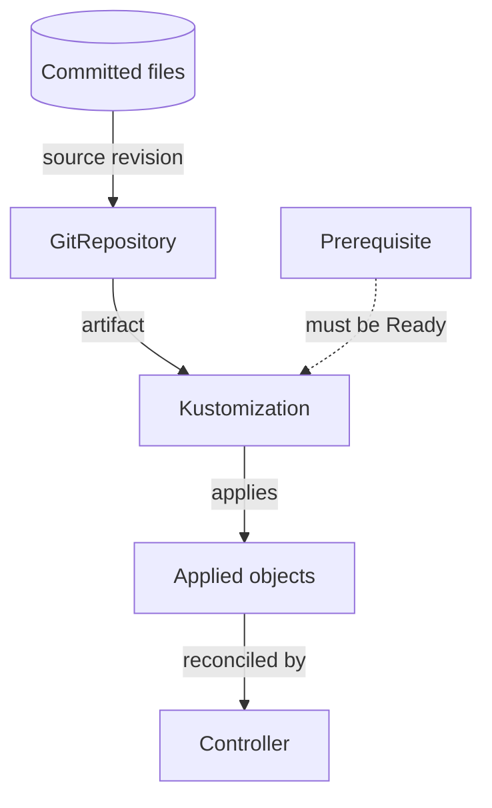

# Flux remediation

Flux applies everything committed under `kubernetes/` once bootstrap is done, reading the `deploy` branch that the [deploy gate](deploys.md) advances. When a Flux resource is stuck, the error you see is often downstream of the real one. Find the earliest failing object first.



A Kustomization waits for every `dependsOn` prerequisite to be Ready. A failure in a source, prerequisite, SOPS decryption, or render step therefore appears later as a missing or failing workload.

## 1. List what is not Ready

```sh
mise exec -- flux get sources all -A
mise exec -- flux get kustomizations -A
mise exec -- flux get helmreleases -A
mise exec -- flux logs --all-namespaces --since=30m
```

Record each failing object's source revision, generation, condition reason, message, and time.

If the `flux-system` source is Ready but behind `main`, run `mise exec -- task deploy:status` first. A commit the gate has not promoted is not a Flux failure, and reconciling will not fetch it.

## 2. Inspect the earliest failure

Look only at the named source, Kustomization, HelmRelease, or dependent resource. Check that the committed path and revision are the ones you expect.

| Message points to | Check | Do not |
| --- | --- | --- |
| Source fetch | Repository URL, revision, and credential reference | Rotate credentials before confirming they are the cause |
| Dependency not ready | The prerequisite's own conditions | Remove the `dependsOn` edge to unblock it |
| SOPS decryption | Encryption metadata and recipient configuration | Print decrypted data |
| `postBuild` substitution | That the referenced Secret has the expected keys | Print the values |
| Helm install or upgrade | Release history and rendered values | Uninstall or roll back outside the skill's remediation steps |

## 3. Reconcile only with approval

Force reconciliation is a live action. Get operator approval, name the exact resource and the transition you expect, and follow the `debug-flux-reconciliation` skill.

## 4. Verify the outcome

Confirm all of these, in order:

1. The source artifact is at the expected revision.
2. The Kustomization or HelmRelease is Ready at the new generation.
3. The controller for the applied objects is ready.
4. The user-visible behavior works.
