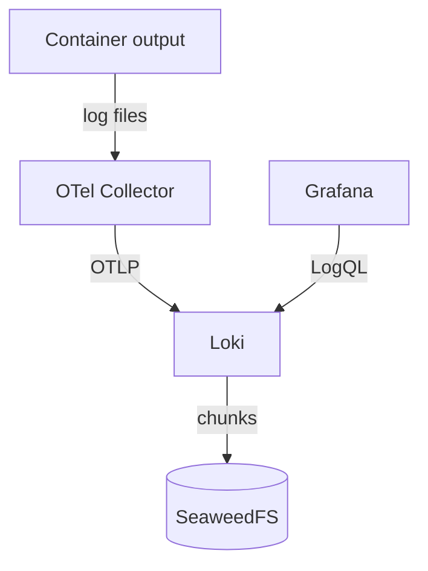

# Kubernetes logs

The OpenTelemetry Collector reads container logs on every node and sends them to Loki. You query them in Grafana; Loki itself is internal only. Metrics live separately in Prometheus.

Loki runs the stock 3.7.9 release as a single monolithic instance. Its WAL is enabled and flushes on shutdown, and it keeps chunks in SeaweedFS. Under [ADR 0044](../decisions/0044-use-stock-shared-s3-with-planned-downtime.md), occasional log loss during crashes or planned maintenance is accepted, so logs are best-effort diagnostics, not an audit trail.



## Find missing or unexpected logs

Start with a namespace, a workload, a time window, and a hypothesis. Then check each stage:

1. **Did the pod produce output?** Read the pod directly. If it logged nothing, the problem is the application, not ingestion.

   ```sh
   mise exec -- kubectl -n <namespace> get pods
   mise exec -- kubectl -n <namespace> logs <pod> --since=20m
   ```

2. **Is the collector running and forwarding?**

   ```sh
   mise exec -- kubectl -n observability get pods
   ```

3. **Does Loki have the stream?** Query a narrow window in Grafana Explore:

   ```logql
   {k8s_namespace_name="<namespace>", severity=~"error|fatal"} |= "<distinctive text>"
   ```

Narrow the stream selector first, then add a line filter. Avoid queries that scan the whole retention window. Never use pod names, request IDs, or other high-cardinality values as stream selectors; inspect them as structured metadata after a bounded selection.

For collector or Loki symptoms, inspect the named deployment and its recent events before changing configuration. The `query-kubernetes-logs` skill has detailed LogQL and ingestion troubleshooting. Do not create diagnostic pods, port-forwards, or synthetic traffic without approval.

## Log-loss alerts

Alerts watch each stage where records could be lost. Critical alerts page through the existing ntfy route; the queue-high warning shows only in Prometheus and Grafana.

| Stage | Alerts fire on |
| --- | --- |
| Collector checkpoints | Failure to load or save reader offsets |
| Collector queue | Queue above 80% (warning) or 95% (critical); failure to enqueue; final export failure |
| Loki WAL | Replay errors or discarded samples; failed WAL writes or checkpoints |
| Coverage | Missing collector or Loki metrics, so an outage cannot look like an empty queue |

A firing alert signals risk, not proven loss. Never restart Loki to clear a WAL recovery alert: keep the evidence, assess the impact, then silence it for that incident.

## Log-delivery canary

A canary DaemonSet proves logs arrive end to end ([ADR 0042](../decisions/0042-bound-numbered-log-confirmation-deadlines.md)). Every ten seconds, each node's probe writes a numbered record to stdout and then looks for it in Loki.

| Alert | Fires when |
| --- | --- |
| `LokiCanaryMissingLogs` | A record is still unconfirmed after 180 seconds |
| `LokiCanaryDeliveryStalled` | No record was emitted, or no query succeeded, for 180 seconds |
| `LokiCanaryCoverageMissing` | Fewer healthy probes than scheduled nodes |

With healthy monitoring, a missing record pages within 270 seconds. The probes verify only their own records, and a detection can mean delay or a query outage rather than loss. Keep probe pods running during collector or Loki restart tests, because a restarted probe forgets what it expected.

## Labels and retention

The logging contract is executable. It defines indexed labels, severity normalization, per-stream retention, and safe query vocabulary. Read it from the source rather than copying its tables:

```sh
mise exec -- python3 scripts/validate-log-contract.py --show
mise exec -- task contracts:validate
```

Older captures may have scrape gaps or use an earlier schema, so compare like with like.

The `query-kubernetes-logs` skill's [pipeline reference](https://github.com/wcygan/anton/blob/main/.agents/skills/query-kubernetes-logs/references/loki-pipeline.md) holds the detailed reader, queue, alert, and canary procedures, including the local verification commands.

## Change and recovery order

If an approved rollout or rebuild touches logging, follow this order. A healthy collector cannot make up for a missing bucket or failed credential delivery.

1. Reconcile the storage-owned `seaweedfs-config` intent.
2. Confirm the `seaweedfs-buckets-ensure` CronJob has created Loki's bucket and credentials.
3. Reconcile the Loki app and wait for it to become ready.
4. Confirm the collector is delivering, using one bounded Grafana query.

This order is not standing permission to reconcile or create test traffic. Before any live step, confirm the exact targets, expected transitions, timeout, rollback, and cleanup.
