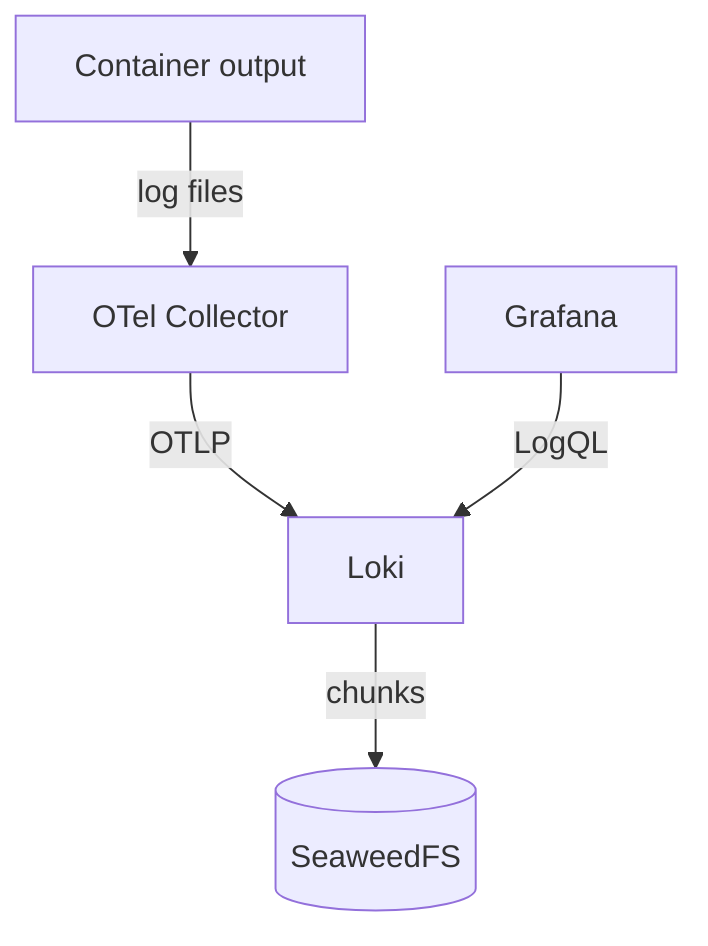

# Kubernetes logs

The OpenTelemetry Collector reads container logs on every node and sends them to Loki. You query them in Grafana; Loki itself is internal only. Metrics live separately in Prometheus.



## Find missing or unexpected logs

Start with a namespace, a workload, a time window, and a hypothesis. Then check each stage:

1. **Did the pod produce output?** Read the pod directly. If it logged nothing, the problem is the application, not ingestion.

   ```sh
   mise exec -- kubectl -n <namespace> get pods
   mise exec -- kubectl -n <namespace> logs <pod> --since=20m
   ```

2. **Is the collector running and forwarding?**

   ```sh
   mise exec -- kubectl -n observability get pods
   ```

3. **Does Loki have the stream?** Query a narrow window in Grafana Explore:

   ```logql
   {k8s_namespace_name="<namespace>", severity=~"error|fatal"} |= "<distinctive text>"
   ```

Narrow the stream selector first, then add a line filter. Avoid queries that scan the whole retention window. Never use pod names, request IDs, or other high-cardinality values as stream selectors; inspect them as structured metadata after a bounded selection.

For collector or Loki symptoms, inspect the named deployment and its recent events before changing configuration. The `query-kubernetes-logs` skill has detailed LogQL and ingestion troubleshooting. Do not create diagnostic pods, port-forwards, or synthetic traffic without approval.

## Labels and retention

The logging contract is executable. It defines indexed labels, severity normalization, per-stream retention, and safe query vocabulary. Read it from the source rather than copying its tables:

```sh
mise exec -- python3 scripts/validate-log-contract.py --show
mise exec -- task contracts:validate
```

Older captures may have scrape gaps or use an earlier schema, so compare like with like.

## Change and recovery order

If an approved rollout or rebuild touches logging, follow this order. A healthy collector cannot make up for a missing bucket or failed credential delivery.

1. Reconcile the storage-owned `seaweedfs-config` intent.
2. Confirm the `seaweedfs-buckets-ensure` CronJob has created Loki's bucket and credentials.
3. Reconcile the Loki app and wait for it to become ready.
4. Confirm the collector is delivering, using one bounded Grafana query.

This order is not standing permission to reconcile or create test traffic. Before any live step, confirm the exact targets, expected transitions, timeout, rollback, and cleanup.
