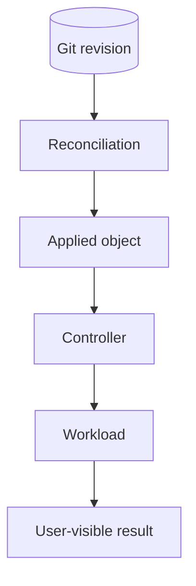

# Routine operations

Use this guide for a read-only health pass or to find where a failure starts. It ends where a change would begin: every live action needs approval and its own procedure.

## Before you start

Confirm which cluster you are talking to, and use the repository's tool versions:

```sh
mise exec -- kubectl config current-context
mise exec -- task --list
```

Run commands through `mise exec` so they use the pinned versions. Take task names from `task --list`, not from old notes.

## Read-only health pass

Check from the bottom up: nodes, then Flux, then the workload you care about.

```sh
mise exec -- kubectl get nodes
mise exec -- flux get sources all -A
mise exec -- flux get kustomizations -A
mise exec -- flux get helmreleases -A
mise exec -- kubectl -n <namespace> get pods,events
```

For the object that looks wrong, run `kubectl describe` and a time-bounded `kubectl logs --since=<window>`. Write down the condition reason and message, the generation, the restart count, and the event times before anything changes them. Redact anything secret before sharing output.

## Find the first failing layer

A broken pod is often a symptom. Walk down the chain and stop at the first layer that is not healthy:



Then use the guide for that layer:

| Symptom | Guide |
| --- | --- |
| Node not Ready, disk, interface, or etcd trouble | [Talos and node health](talos.md) |
| Kustomization or HelmRelease not Ready | [Flux remediation](flux.md) |
| Volume attach or storage network failure | [Storage](storage.md) |
| Missing or delayed alerts | [Alert delivery](alerts.md) |
| Missing logs | [Kubernetes logs](logging.md) |

## Changing anything

Force reconciliation, restarts, port-forwards, debug pods, storage changes, and Talos applies are live actions. Each needs explicit operator approval, the matching subsystem procedure, and a stated expected result. A passing repository validation is not, by itself, a reason to apply.
