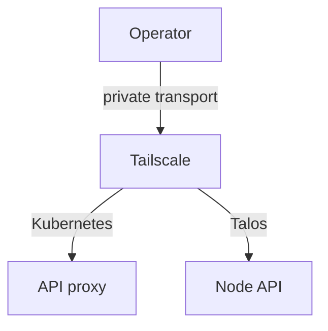
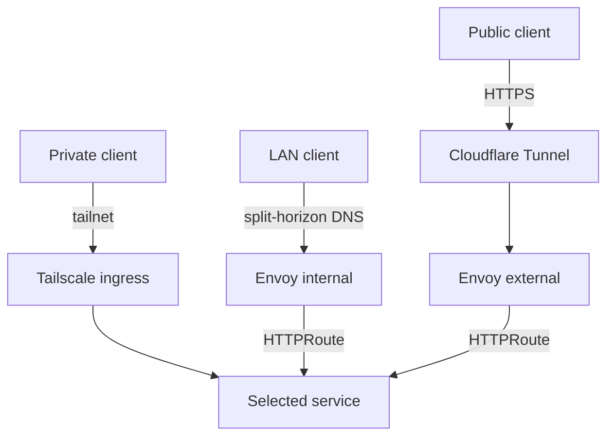

# Remote access

Operators and applications reach Anton through separate paths. Each path has its own transport and authorization, and access through one never grants access through another.

| Who | Reaches | Path |
| --- | --- | --- |
| Operator | Kubernetes API | Tailscale → Kubernetes API proxy, with restricted identity mapping |
| Operator | Talos API | Tailscale → the selected node's Talos API directly |
| Private client | Selected web services | Tailscale ingress → service |
| LAN client | Internal routes | Split-horizon DNS → Envoy internal gateway → service |
| Anyone | Public routes | Cloudflare Tunnel → Envoy external gateway → service |

## Operator APIs



The Kubernetes proxy and the Talos API use different client contexts and credentials. Choosing one does not select the other.

## Application paths



LAN clients resolve route hostnames through split-horizon DNS, which answers with the internal gateway. Only routes attached to the external gateway are published through the tunnel.

## Connect and verify

Before a Kubernetes CLI session, confirm the context and reach the API:

```sh
mise exec -- kubectl config current-context
mise exec -- kubectl get nodes
```

Prefer the Tailscale Kubernetes API proxy context. The admin context is a documented fallback only.

If the connection fails, place the failure in one of these layers before trying to fix it:

1. Local credentials or kubeconfig.
2. Tailnet connectivity.
3. The API proxy.
4. The cluster API itself.

The `anton-remote-access` skill covers setup and recovery. Node-level access and changes follow the [Talos guide](talos.md).

Never publish the tailnet name, private hostnames, addresses, or node identifiers in docs or committed examples. Use placeholders such as `<tailnet-name>`.
