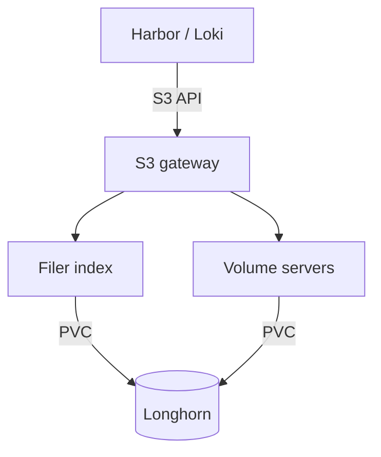

# SeaweedFS object storage

SeaweedFS provides Anton's internal S3-compatible object storage. Harbor stores image blobs in it, and Loki stores log chunks in it. It is not published to the internet.

## Committed shape

The `Seaweed` resource in `kubernetes/apps/storage/seaweedfs-config/` declares:

| Component | Replicas | Storage |
| --- | --- | --- |
| Master | 3 | — |
| Volume server | 3, one per node | 120 GiB Longhorn claim each |
| Filer | 2 | 4 GiB Longhorn claim each, for the filer index |
| S3 gateway | 2 | — |

The image is `chrislusf/seaweedfs:4.40`, with no custom runtime patches mounted. SeaweedFS replication is `000` because Longhorn provides block durability underneath.

These are committed settings. They do not show where pods are running, whether data is intact, or which image is deployed right now.

An object is only readable when both the filer index and the volume data are intact. A healthy Longhorn volume does not prove the object store is consistent.

## Connect a client

| Client | Endpoint |
| --- | --- |
| A workload in the cluster | The in-cluster S3 service |
| A LAN client | The internal gateway route, over HTTPS |

Signed S3 requests break across redirects, so point clients at the final endpoint. Harbor and Loki each have their own scoped S3 identity, delivered through External Secrets. Do not print the generated S3 configuration.

Buckets and identities are declared in the shared storage configuration and created by the `seaweedfs-buckets-ensure` CronJob.

## Before changing anything

Do not change PVCs, volume collections, filer data, or the runtime image without a fresh, approved recovery and cutover plan. Use the `seaweedfs-ops` skill for recovery, capacity, and reclamation work.

The manifest names the stock image, but that does not show the cluster runs it. The work to retire custom runtime patches passed isolated qualification; production cutover is not authorized, and gates remain open. Loki's committed configuration does not establish a cutover either; it runs as a single monolithic instance, keeps chunks in SeaweedFS, and keeps its WAL on a separate 20 GiB Longhorn volume. The [storage record](../records/storage-reliability-and-capacity.md) summarizes what was tested.
