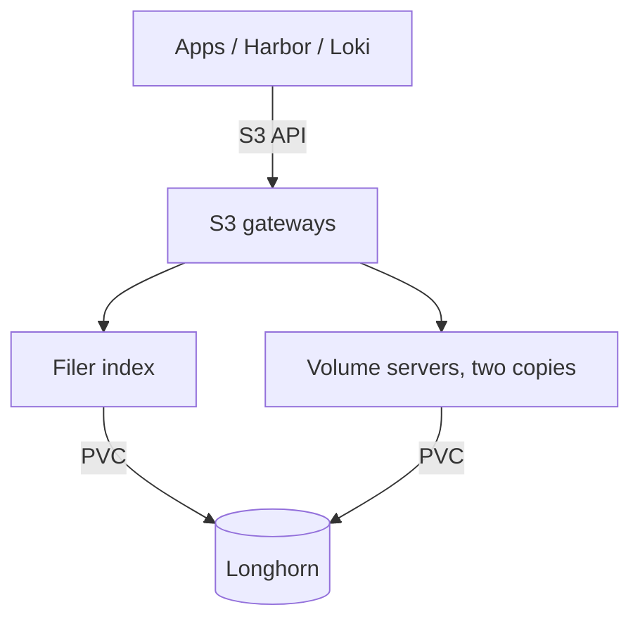

# SeaweedFS object storage

SeaweedFS provides Anton's internal S3-compatible object storage, shared by applications, Harbor (image blobs), and Loki (log chunks). It is not published to the internet. Since the October 2026 cutover it runs unmodified upstream releases, and planned S3 downtime is an accepted cost ([ADR 0044](../decisions/0044-use-stock-shared-s3-with-planned-downtime.md)).

## Committed shape

The `Seaweed` resource in `kubernetes/apps/storage/seaweedfs-config/` declares:

| Component | Replicas | Storage |
| --- | --- | --- |
| Master | 3 | — |
| Volume server | 3, one per node | 160 GiB Longhorn claim each |
| Filer | 2 | 4 GiB Longhorn claim each, for the filer index |
| S3 gateway | 2 | — |

The image is stock SeaweedFS 4.48, pinned by digest. Default placement is `001`: each volume keeps two copies on different volume servers, and therefore on different nodes ([ADR 0043](../decisions/0043-keep-two-seaweedfs-copies-for-maintenance.md)). Longhorn also replicates every claim underneath.

These are committed settings. They do not show where pods are running right now or whether stored data is intact.

An object is readable only when both the filer index and the volume data are intact. A healthy Longhorn volume does not prove the object store is consistent, and two copies do not make SeaweedFS available while a node is down.

## Connect a client

| Client | Endpoint |
| --- | --- |
| A workload in the cluster | The in-cluster S3 service |
| A LAN client | The internal gateway route, over HTTPS |

Signed S3 requests break across redirects, so point clients at the final endpoint. Each consumer has its own scoped S3 identity, delivered through External Secrets. Do not print the generated S3 configuration.

Buckets and identities are declared in the shared storage configuration and created by the `seaweedfs-buckets-ensure` CronJob.

## Integrity and read alerts

Alerts detect problems; none of them repairs data or restores writability.

| Alert | Fires when | Severity |
| --- | --- | --- |
| `SeaweedFSReadOnlyVolumes` | A volume server reports read-only volumes for 5 minutes | critical |
| `SeaweedFSVolumeMetricsUnavailable` | Fewer volume metrics targets than volume servers for 10 minutes | critical |
| `SeaweedFSVolumeIntegrityFailure` | Volume logs report an integrity, index, or CRC failure | critical |
| `SeaweedFSS3ReadProbeFailed` | A gateway's built-in probe fails two verified reads in a row | critical |
| `SeaweedFSS3ReadFailures` | Repeated transport or streaming failures on reads | warning |
| `SeaweedFSS3Read5xx` | Repeated 5xx responses to reads | warning |
| `SeaweedFSS3MonitoringUnavailable` | Gateway metrics or probe results are missing or stale | warning |

Each S3 gateway runs a sidecar that reads a fixed 64 KiB object every minute and checks its length and hash. One fixture cannot cover every stored object, so after maintenance also check a cold Harbor pull and a historical Loki query.

Read-only volumes are not proof of corruption; full slots or deliberate maintenance also cause them. For an integrity failure, record the status and logs, preserve the original files outside the affected system, and rehearse any repair on a disposable copy before seeking approval. Never force a volume writable to silence an alert.

## Node maintenance

Plan node work as S3 downtime. Two copies remain, but uninterrupted service during a node outage is not promised.

1. Run the read-only placement audit, `scripts/verify-seaweedfs-maintenance.py`, and confirm quorum, Longhorn health, and free capacity.
2. Confirm a tested, independent recovery point exists for any unique uploads.
3. Fence writers: pause Harbor's jobs and front door, flush and stop Loki cleanly, and hold application writers.
4. Maintain one node with the matching Talos procedure, and wait for it and its storage workloads to recover before touching another.
5. Restore the gateways and writers, then verify known objects, a Harbor pull and push, and fresh Loki ingestion.

Stop if previously readable data is missing, quorum is lost, or a PVC changes identity. Every step needs its own approved targets.

## Detailed procedures

The `seaweedfs-ops` skill holds the full procedures:

- [Node maintenance](https://github.com/wcygan/anton/blob/main/.agents/skills/seaweedfs-ops/references/node-maintenance.md)
- [Integrity alerts and durability review](https://github.com/wcygan/anton/blob/main/.agents/skills/seaweedfs-ops/references/health-alerts.md)
- [The completed stock cutover and its rollback](https://github.com/wcygan/anton/blob/main/.agents/skills/seaweedfs-ops/references/stock-cutover.md)

Do not change PVCs, volume collections, filer data, or the runtime image without a fresh, approved recovery plan.
