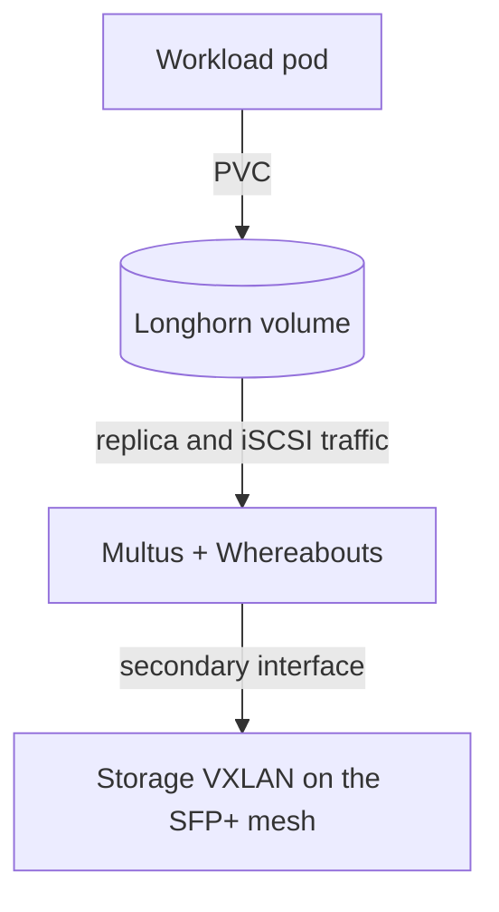

# Block storage and the storage network

Longhorn provides replicated block volumes for stateful workloads. Its replica and iSCSI traffic run on a dedicated storage network, apart from ordinary pod traffic. This guide covers both. For object storage, see [SeaweedFS](seaweedfs.md).

## How a volume reaches its replicas

Multus gives Longhorn's instance managers a second network interface, and Whereabouts assigns its address. That interface carries traffic over a VXLAN on the direct 10 Gbit mesh between nodes ([ADR 0009](../decisions/0009-10g-sfp-full-mesh-networking.md), [ADR 0017](../decisions/0017-adopt-multus-for-longhorn-storage-network.md)).

## Diagnose an attachment failure

An attachment that was requested is not the same as one that succeeded. Follow the chain for the affected pod, in order:

1. The pod's network annotation.
2. The `NetworkAttachmentDefinition` it names.
3. The Whereabouts address allocation.
4. The CNI attachment result in the pod's events.
5. The Longhorn instance-manager path that uses the interface.

If the Flux resource for this layer is itself failing, use [Flux remediation](flux.md). For runtime faults, use the `longhorn-volume-ops` or `longhorn-node-ops` skill.

## Protect the data

Replication protects against losing a node. It does not protect against deletion, corruption, or losing the cluster, and no off-cluster backup currently runs.

- Never delete PVCs, Longhorn volumes, or replicas as a cleanup shortcut.
- Volume changes, replica cleanup, and node maintenance need approval and the matching skill.
- Before reclaiming space, prove each item is orphaned. The [storage record](../records/storage-reliability-and-capacity.md) shows how that was done safely.
