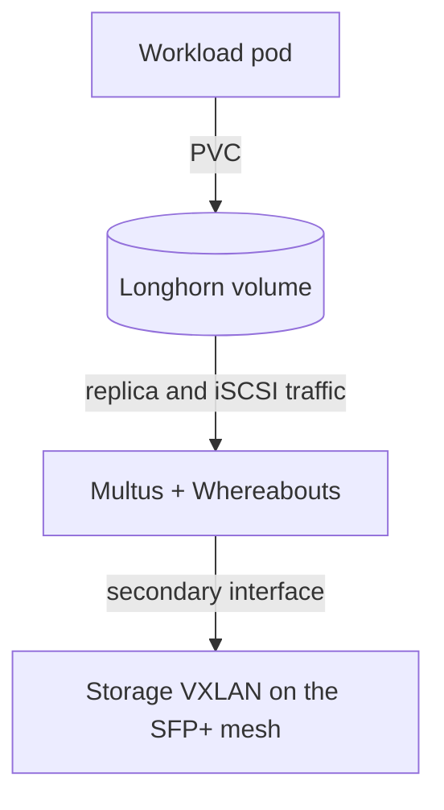

# Block storage and the storage network

Longhorn provides replicated block volumes for stateful workloads. Its replica and iSCSI traffic run on a dedicated storage network, apart from ordinary pod traffic. This guide covers both. For object storage, see [SeaweedFS](seaweedfs.md).

## How a volume reaches its replicas

Multus gives Longhorn's instance managers a second network interface, and Whereabouts assigns its address. That interface carries traffic over a VXLAN on the direct 10 Gbit mesh between nodes ([ADR 0009](../decisions/0009-10g-sfp-full-mesh-networking.md), [ADR 0017](../decisions/0017-adopt-multus-for-longhorn-storage-network.md)).

## Diagnose an attachment failure

An attachment that was requested is not the same as one that succeeded. Follow the chain for the affected pod, in order:

1. The pod's network annotation.
2. The `NetworkAttachmentDefinition` it names.
3. The Whereabouts address allocation.
4. The CNI attachment result in the pod's events.
5. The Longhorn instance-manager path that uses the interface.

If the Flux resource for this layer is itself failing, use [Flux remediation](flux.md). For runtime faults, use the `longhorn-volume-ops` or `longhorn-node-ops` skill.

## Protect the data

Replication protects against losing a node. It does not protect against deletion, corruption, or losing the cluster, and no off-cluster backup currently runs. SeaweedFS keeps its own two copies on top of Longhorn; see [SeaweedFS](seaweedfs.md) for what that does and does not cover.

- Never delete PVCs, Longhorn volumes, or replicas as a cleanup shortcut.
- Volume changes, replica cleanup, and node maintenance need approval and the matching skill.
- Before reclaiming space, prove each item is orphaned. The [storage record](../records/storage-reliability-and-capacity.md) shows how that was done safely.

## Recurring in-cluster recovery checkpoints

`storage/cluster-recovery` runs daily at 06:00 UTC without stopping production.
It derives the three Seaweed volume, two filer and one Loki PVC from their current
pods, records PVC/PV identities, and creates serial CSI snapshots. These are
per-volume crash-consistent checkpoints: ongoing writes mean the six snapshots
do not represent one application-consistent instant.

The rehearsal restores temporary PVCs inside the cluster. A sealed storage Job
mounts all sources read-only, opens only disposable copies of the two filer
LevelDB stores, validates sampled Seaweed index/header/payload records, and finds
real filer-referenced Harbor and Loki payloads. Harbor samples must match their
content-addressed SHA256 and both available volume copies. Loki samples must be
readable; multiple present copies must agree. A separate sealed Job hashes a
bounded sample of files from the restored Loki PVC. It does not replay Loki WAL,
audit all S3 references, or restore Harbor's database. Known historical log gaps
are not reclassified as a passing whole-corpus integrity result. Unavailable
references encountered while searching for a sample are counted separately;
an observed bad header, truncated payload or divergent checksum fails the Job.

The coordinator records only small hash/count summaries in
`storage/cluster-recovery-journal`; all payload bytes stay in the cluster.
Verifier Pods have no service-account token and deny-all network policies.
The coordinator can reach only the Kubernetes API, using namespace-scoped
permissions in `storage` and `observability` and read-only PV/snapshot-content
access. Kubernetes RBAC cannot restrict dynamically created resources by label;
the controller therefore requires its ownership label and exact UID for cleanup.

The latest two verified generations are retained. Both remain protected while a
new candidate is captured, so a run temporarily holds at most three generations.
Success removes the oldest; failure removes the failed candidate and keeps both
verified generations. Temporary Jobs, clones and policies are removed. A durable
UID registry guards every deletion; an object carrying copied ownership labels
without a matching registered UID stops cleanup for operator review. A Lease, `Forbid` concurrency,
deadlines, source-volume health checks, and a physical-space gate bound the work.
The space gate requires two distinct Ready schedulable nodes, each with space
for a full restore replica after disk reserves plus 20 percent headroom. Restored
volumes must become healthy and attached before the verifier gate opens;
failure leaves production and the last verified checkpoint untouched. A crashed
run is reconciled by the next run after Lease expiry.
If the API cannot establish whether publishing a new verified checkpoint
committed, cleanup conservatively retains that candidate too until the journal
can be read again. This exceptional third generation is never mistaken for an
additional verified restore point.

The new `longhorn-recurring-recovery` snapshot class has deletion policy `Delete`.
The existing `longhorn-wal-forensics` class and manually retained maintenance
snapshots are outside this controller's ownership. These local checkpoints do
not protect against losing the cluster. A full Harbor recovery still needs a
separately designed database checkpoint, such as a native CNPG scheduled backup,
and a coordinated database/S3 restore rehearsal. No data is exported to a Mac or
any other external destination by this workflow.

For an explicitly approved one-off rehearsal, create a Job from the CronJob and
inspect its completion and the journal. The source entry point is
`scripts/cluster-recovery-checkpoints.py`; it refuses coordinator execution
outside Kubernetes.

`ClusterRecoveryCheckpointFailed` alerts on failed Jobs owned by the scheduled
CronJob. `ClusterRecoveryCheckpointStale` alerts after 30 hours without a successful
scheduled rehearsal, including a never-successful installation after its initial
30-hour grace period; absent CronJob metrics also alert. For either alert, inspect
the coordinator Job's logs and journal `phase`, `error`, `verified` and
`verified_report` fields, then check current Longhorn node/disk eligibility and
physical free space. A new snapshot is not evidence of a verified restore.
Compare any remaining temporary objects' exact UIDs with the journal registry
before cleanup. Dedicated leftover/headroom alerts are deferred because the
controller's UID registry and conservative capacity calculation are not exported
as robust Prometheus metrics.

## Serial Longhorn engine upgrades

A manager/chart upgrade does not prove that existing volume engines advanced.
Automatic engine upgrades stay disabled so an operator owns the sequence. Check
both `spec.image` and `status.currentImage` on every Longhorn volume. Bring older
engines to the current manager's supported engine version before advancing the
manager one minor release; then advance the engines to match it. Keep V1 volumes
on V1 unless a separate migration is approved. Longhorn downgrades are unsupported.

`scripts/upgrade-longhorn-engines.py` defaults to a read-only plan. Run `--help`
through `mise exec -- python3` for its required kubeconfig, operator context,
cluster UID, target and snapshot-prefix arguments. It requires a fresh Ready
Retain-policy CSI snapshot for every exact source PVC/volume UID, both running
replicas, all Longhorn nodes Ready and the advertised engine image deployed on
all nodes. The snapshot annotations are `anton.wcygan.dev/source-volume-uid` and
`anton.wcygan.dev/source-pvc-uid`; creating that reviewed checkpoint set is a
separate operation. `--execute` requires explicit live-change authorization.

The tool changes one `spec.image` with UID/resource-version/image preconditions,
then waits for the running engine and both active replicas to match before
advancing. It stops on identity changes, degraded volumes or convergence timeout;
inspect the exact failure before resuming. It never creates exports, repairs data,
rolls back, or migrates data engines.
