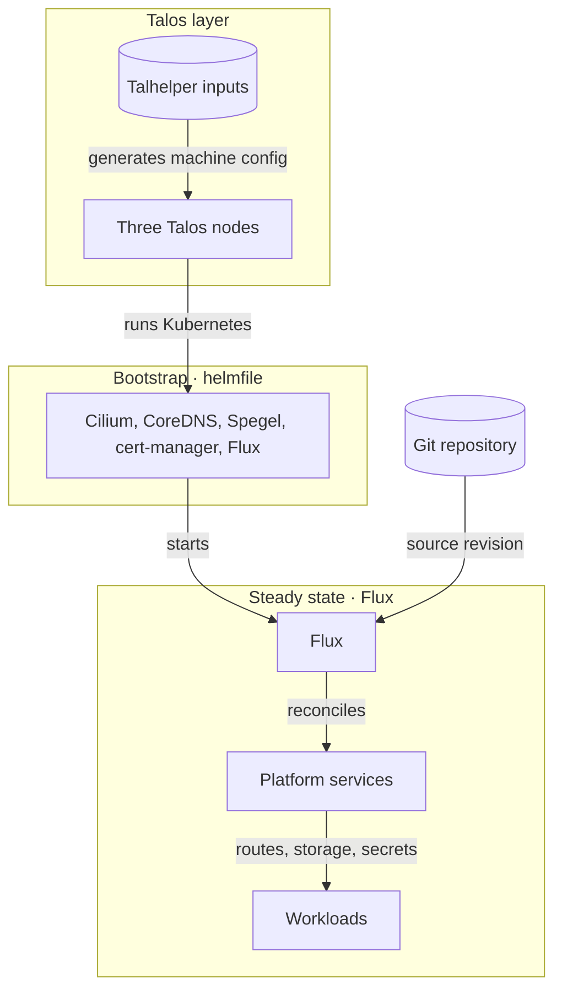

# Platform architecture

Anton has three ownership layers. Talos owns the machines, a one-time bootstrap gets Kubernetes to the point where Flux can run, and Flux owns everything committed under `kubernetes/` after that. Knowing which layer owns a component tells you where to change it and which procedure applies.

## Layers

| Layer | Source | Changed by | Guide |
| --- | --- | --- | --- |
| Machines | `talos/talconfig.yaml`, `talos/talenv.yaml`, and patches | Generating config, then a separately approved Talos apply | [Talos and node health](../guides/talos.md) |
| Bootstrap | `bootstrap/helmfile.d/` | Rebuilding the cluster from scratch | — |
| Steady state | `kubernetes/apps/` | A commit on `main` that passes the [deploy gate](../guides/deploys.md), which Flux then reconciles | [Flux remediation](../guides/flux.md) |

Bootstrap installs the network, DNS, certificate issuer, registry mirror, and Flux so the cluster can start. Flux then manages those same components from Git along with everything else. Generated Talos machine configuration is never edited by hand.

A merged change records intent. It proves nothing about the live cluster until the owning layer has applied it and the result has been observed.

## How workloads use the platform

Workloads do not provision infrastructure directly. They declare what they need, and shared platform services supply it:

- **Exposure:** an `HTTPRoute` on the internal or external gateway, or a Tailscale ingress. See [secrets and exposure](../guides/secrets-and-exposure.md).
- **Storage:** a Longhorn PVC, a CloudNativePG database, or a SeaweedFS bucket declared in the shared storage configuration. See [data services](capabilities.md#data-services).
- **Credentials:** an `ExternalSecret` that External Secrets Operator fills from 1Password.
- **Visibility:** metrics scraped by Prometheus and container logs collected into Loki. See [operations and visibility](capabilities.md#operations-and-visibility).

Longhorn replica traffic runs on a separate storage network, apart from primary pod networking. The [storage guide](../guides/storage.md) describes that path.
