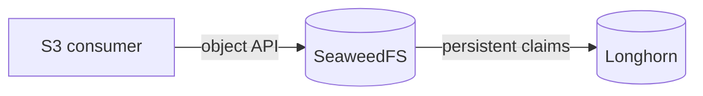

# Platform capabilities

This map lists the shared services Anton provides and the component behind each one. It is built from the bootstrap and Flux registrations in Git, so it describes what is committed, not what is currently healthy.

## Data services

| Capability | Provider and role |
| --- | --- |
| Block storage | **Longhorn** — replicated CSI volumes for stateful workloads. |
| Object storage | **SeaweedFS** — internal S3-compatible storage for Harbor and Loki. |
| Managed PostgreSQL | **CloudNativePG** — operator-managed application databases. |
| Redis-compatible cache | **Dragonfly operator** — managed cache instances. |
| Container registry | **Harbor** — OCI registry with image blobs in SeaweedFS. **Spegel** separately shares images between nodes' local stores. |
| Volume snapshots | **CSI snapshot controller** — Kubernetes snapshot objects. |

SeaweedFS runs on Longhorn volumes. Longhorn keeps those volumes available when a node fails; SeaweedFS still owns object metadata and bucket behavior.

:::caution No off-cluster backup
Snapshots and replication are not backups. The committed Longhorn backup target is empty, and no recurring off-cluster backup runs. See the [storage record](../records/storage-reliability-and-capacity.md) for what has been rehearsed.
:::

## Delivery and access

| Capability | Provider and role |
| --- | --- |
| Node operating system | **Talos Linux** — immutable, API-managed nodes. |
| GitOps | **Flux CD** — reconciles committed manifests and Helm releases. |
| Pod networking | **Cilium** — primary CNI and network policy enforcement. |
| Internal DNS | **CoreDNS** for cluster names; **k8s-gateway** for split-horizon answers on the LAN. |
| Private remote access | **Tailscale** — operator API access and selected private service ingress. |
| Public ingress | **Cloudflare Tunnel + Envoy Gateway** — explicitly declared public routes. |
| Internal ingress | **Envoy Gateway** — internal Gateway API routes. |
| DNS and certificates | **external-dns + cert-manager** — declared DNS records and certificate issuance. |
| Secret delivery | **SOPS with age** for encrypted repository files; **External Secrets Operator + 1Password SDK** for application credentials. |
| Admission policy | **Kyverno** — policy enforcement with explicit exceptions. |

Operators reach the Kubernetes API and each node's Talos API through Tailscale. These are separate endpoints with separate credentials. Applications have their own private, LAN, and public paths; [remote access](../guides/remote-access.md) shows all of them.

## Operations and visibility

| Capability | Provider and role |
| --- | --- |
| Metrics and dashboards | **kube-prometheus-stack** — Prometheus, Grafana, and Kubernetes metric integrations. |
| Alert delivery | **Alertmanager + ntfy** — selected notifications delivered over private access. |
| Kubernetes logs | **OpenTelemetry Collector + Loki** — collection, retention, and Grafana queries. |
| Hardware telemetry | **smartctl-exporter + NVMe power collector** — disk health and power-state readings. |
| Cluster and network views | **Headlamp + Hubble** — private admin UI and Cilium flow visibility. |
| Resource sizing advice | **Goldilocks + VPA recommender** — recommendations only; automatic resizing is off. |
| Configuration reloads | **Reloader** — restarts selected workloads when a declared Secret or ConfigMap changes. |

Metrics, logs, and notifications fail independently. A quiet alert channel does not mean metrics are healthy, and a missing log line does not mean the workload stopped. The [operations guide](../guides/operations.md) shows how to check one service over one interval.

Retired experiments, such as the lakehouse and ClickStack, are described in [records](../records/learning-experiments.md) rather than listed here.
