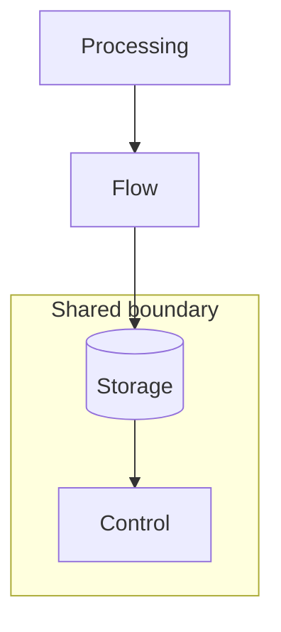

import DiagramExamples from '@site/src/components/DiagramExamples';
import ShapeGallery from '@site/src/components/Diagram/ShapeGallery';

# Visual design system

Every diagram on this site uses one shared system of roles, shapes, spacing, and
type, defined in this repository. Light is the default theme, and a visitor's
choice is remembered. In dark mode, a neutral charcoal page holds a deeper diagram
stage and a slightly lighter group enclosure, so color stays on the actors and data.

## Visual reference

These are the real shared components; switch themes to compare. The example shows
the roles, not deployed topology.

<DiagramExamples />

| Role | Meaning | Shape |
| --- | --- | --- |
| Processing | Applications and compute | Rounded rectangle |
| Flow | Network and transport | Rounded rectangle |
| Storage | Persisted data | Cylinder |
| Control | Reconciliation and orchestration | Rounded rectangle |
| Group | Ownership or system boundary | Labeled enclosure |



## Shape library

Shape says what kind of thing a node is; role sets its color. Use only as many
shapes as you need to tell the actors apart. The gallery is a vocabulary, not a
claim about deployed topology, replication, or trust.

<ShapeGallery />

| Shape | `shape` value | Use |
| --- | --- | --- |
| Server chassis | `server` | Physical machine, separate from a workload |
| Object bucket | `bucket` | S3 objects, separate from a block volume |
| Folded document | `document` | Manifest, configuration, or source artifact |
| Client screen | `client` | Browser or operator workstation |
| Decision diamond | `decision` | A condition with every outgoing branch labeled |
| Volume / disk | `volume` | Label explicitly as a PVC, block volume, or physical disk |
| Gateway with ports | `gateway` | Routing between ingress and egress edges |
| Dashed enclosure | `DiagramGroup variant="dashed"` | Named namespace, ownership, or trust boundary |
| Replica stack | `replicas` | Copies of one resource; never shards or partitions |

`box` and `storage` remain available for ordinary services and structured stores.
Use `shape="server"` or another listed shape on `DiagramNode`; its typed API
rejects unknown shape names. Shape details use the same role tokens and themes.
Enlarge the shape or wrap its label before reducing text size. Diamonds need short
condition labels and generous space around branches. A dashed border alone does
not establish a security boundary: name the actual meaning.

The extended shapes are SVG components. Keep Mermaid nodes in its ordinary
flowchart syntax, with semantic roles; use the SVG components when the exact new
shape matters. Mermaid styling overrides remain disallowed.

## Create a visual

Use Mermaid for ordinary relationships. Assign each declared node exactly one of
`processing`, `flow`, `storage`, or `control` with the inline `:::` syntax above.
Panels and themes are automatic. Use flowcharts; introduce other Mermaid diagram
types only after adding their shapes and validation to the shared system.

Use the components exported by `docs/src/components/Diagram/index.tsx` for custom
geometry. Put the composition in `docs/src/components/` and import it into the
page, as this page does. `Diagram` requires a title, description, width, and height;
it supplies the panel, SVG, accessible description, and instance-safe arrow marker.
`DiagramNode` requires a semantic role and centers its label. Pass an array of
strings for multiline labels. `DiagramGroup` draws an enclosure; `DiagramArrow`
uses the enclosing diagram's marker. Do not nest panels or pass local colors.

```tsx
import {Diagram, DiagramNode, DiagramArrow} from './Diagram';

<Diagram title="Request flow" description="A client sends a request to a service."
  width={360} height={120}>
  <DiagramNode x={10} y={35} width={130} height={48}
    label="Client" role="processing" />
  <DiagramArrow d="M 140 59 H 218" />
  <DiagramNode x={220} y={35} width={130} height={48}
    label="Service" role="flow" />
</Diagram>
```

Label a connector only when the label adds meaning, and put transport detail in a
short caption. Keep direction, dependencies, uncertainty, and ownership visible.
Labels and shapes must make sense without color. A diagram explains; it is not
evidence of live health.

## Change the system

`docs/src/css/tokens.css` is the only color source. `custom.css` maps those tokens
to Mermaid and SVG; never put colors or Mermaid styling directives in a page.
Keep the accepted light/dark pairs together. Do not import a personal skill or
an external theme at runtime.

Run `mise exec -- bun run --cwd docs check:design`, `typecheck`, and `build` after
changes. The build runs the design guard automatically. It rejects raw SVG and
local styling in documentation, Mermaid palette overrides and missing roles,
component color overrides, and token contrast regressions. It checks text at
4.5:1 and visible shape/connector separation at 3:1. Decorative panel borders do
not carry meaning and are not required to reach that contrast.

Inspect this page and the home page at desktop and phone widths in both themes.
Check label size, wrapping, enclosure crossings, arrowheads, clipping, and reading
order. A passing contrast check cannot judge whether the result looks good.
